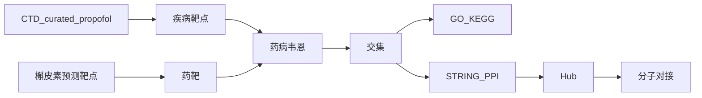

# 昱阳课题研究计划（重做版 · 2026-10-16）

> **本版取代**旧「双口径 DEG∪CTD × 实验∪预测」。旧稿归档：`01_研究计划_ResearchPlan_旧双口径_archived_2026-10-16.md`。  
> **整夹备份：** `E:\RProject\_备份_Backup\昱阳项目_重做前_2026-10-16\`；项目内归档：`_archived_旧双口径_2026-10-16\`。  
> 口径：计算预测 / in silico；**禁止**写成「槲皮素治疗丙泊酚暴露」疗效结论。  
> 已引用：网络药理学（CTD_curated + 韦恩/PPI）+ 分子对接 FROZEN + VizStandards + DeliveryStandards（课题双报告 §2.1）。

---

## 1. 科学问题（锁定表述）

以 **CTD curated（Direct Evidence）** 获取丙泊酚相关疾病/化学–基因靶点为疾病侧；以 **槲皮素（Quercetin, PubChem CID 5280343）预测药物靶点** 为药物侧；二者取交集，做一轮富集、STRING PPI，并对核心 hub 做分子对接。

**可写：** 丙泊酚相关靶点 × 槲皮素预测靶点的网络药理学与对接（计算预测）。  
**不可写：** 治疗 / 已验证机制 / 湿实验结论。

> 用语说明：用户口令「CTD 疾病治愈靶点」按网药冻结口径落实为 **CTD_curated（审编 / Direct Evidence）**，不用 CTD_any。

---

## 2. 与旧版差异（强制）

| 项 | 旧双口径 | **本版重做** |
|----|----------|----------------|
| 疾病侧 | GSE106799 DEG ∪ CTD | **仅 CTD_curated**（propofol 化学–基因；人/鼠映射到统一符号） |
| 药物侧 | ChEMBL±BindingDB 实验 ∪ 多站预测 | **仅槲皮素预测靶点**（STP 为主；可并列 1–2 站并分层标注，**不作实验层门槛**） |
| DEG / GEO | 主病侧 | **本版不跑 DEG**（旧 GEO 仅作背景参考，不进主交集） |
| 网络图 | HCTP 含药(A)/成分(B)色块层 | **禁止**药物色块层、化合物色块层；只做 **靶点–通路** 与/或 **STRING PPI** |
| 对接 | hub × 槲皮素 | 同左；每任务登记 `center_source` |

---

## 3. 目录（现行）

```text
昱阳项目/
  README.md
  01_分析报告_AnalysisReport/          ← 计划 / 阶段汇总 / 终局双报告
  02_主执行_CTDcurated_QuercetinPredicted/
    01_靶点获取与交集_TargetsAndOverlap/
    02_富集与PPI_EnrichPPI/
    03_分子对接_Docking/
  _archived_旧双口径_2026-10-16/       ← 旧 02/03/_shared_scripts（只读参考）
```

仓外整夹备份：`E:\RProject\_备份_Backup\昱阳项目_重做前_2026-10-16\`。

---

## 4. 分析路线



### 4.1 疾病靶点（CTD_curated）

| 规则 | 要求 |
|------|------|
| 库 | CTD chemical–gene；化学物 = **propofol** |
| 证据 | **Direct Evidence / curated only**（不用 any） |
| 物种 | 优先人源；鼠源映射到人 HGNC（或课题统一小鼠符号，全程一种） |
| 落盘 | `01_…/01_初始数据_RawInitial/01_CTD_Propofol_curated/` + `DATA_SOURCE.md` |
| 产出 | `疾病靶点_CTD_curated.csv` |

可复用旧档 `_archived_…/03_补充口径…/05_CTD_Propofol/` 中 **已核实 curated** 行；须重算并写明下载/过滤日期。

### 4.2 药物靶点（槲皮素 · 预测）

| 规则 | 要求 |
|------|------|
| 配体 | Quercetin · CID **5280343** |
| 主源 | SwissTargetPrediction（Probability>0，剔除 0） |
| 可选并集 | PharmMapper / TargetNet / BATMAN 等；**每源独立 CSV + 证据标签 `predicted`** |
| 明确不做 | 本版主池**不要求** ChEMBL/BindingDB 实验层（旧实验表仅归档参考） |
| 落盘 | `…/02_STP_Quercetin_Predicted/`（及可选多站子夹） |

### 4.3 交集与图册

1. 药病韦恩（两集：Drug predicted ∩ Disease CTD_curated）→ 微生信/jvenn 两集模板。  
2. 一轮 GO / KEGG（ORA；交集过小则在报告中诚实标注效能不足）。  
3. **STRING PPI**（建议 score≥900；代码布局 + Degree 渐变；**content-hash 去重嵌报告**）。  
4. **靶点–通路网络（可选）**：节点仅靶点+通路；**不出现**药味/成分色块层（本课题特例，覆盖通用 HCTP 默认）。  
5. **禁止出图：** HCTP 药–成分–靶–通路多层色块图、药味 UpSet、药–成分桑基（因本版无复方成分瀑布）。

### 4.4 分子对接

- 配体：槲皮素（已有 pdbqt 可自归档复制并重登记）。  
- 受体：PPI / 度中心性 Top hub（建议 5–10；须可溯源基因表）。  
- 引擎与盒子：分子对接技能 SOP + FROZEN；**每任务 `center_source`**。  
- 交付：summary、热图、PyMOL big/surface/detail/result。

---

## 5. 阶段与完成判据

| 阶段 | 目录 | 完成判据 |
|------|------|----------|
| A 靶点 | `01_靶点获取与交集_…` | CTD_curated 表 + 预测药靶表 + 交集表 + 韦恩；STATUS |
| B 富集 PPI | `02_富集与PPI_…` | GO/KEGG + STRING；**无 A/B 色块网络图**；STATUS |
| C 对接 | `03_分子对接_…` | hub 对接批次 + center_source 齐全；STATUS |
| D 报告 | `01_分析报告/03_最终报告` | 论文式+方法论双报告（§2.1 正文嵌图） |

**明确不做（本版）：** WGCNA、ML 选 hub、疗效宣称、DEG 主病池、HCTP 药/成分层出图、MD（除非另开）。

---

## 6. 技能组合（有序）

1. 网络药理学 — CTD_curated、韦恩、PPI、靶–通路（无 A/B）  
2. 分子对接 — AutoDock-GPU 默认路径  
3. VizStandards + DeliveryStandards（双报告嵌图）  

---

## 7. 风险与局限

- CTD curated 边为策展关联 ≠ 本暴露模型因果。  
- 预测药靶假阳性高；多站仅作分层，勿称湿实验验证。  
- 无 DEG 后与旧「暴露表型」叙事脱钩，报告须写清「靶点来自 CTD curated，非本 GEO 差异基因」。  
- 对接分 ≠ 体内活性。

---

**执行默认（本版锁定）：** 疾病 = CTD_curated（propofol）；药物 = 槲皮素预测靶；网络图无药物/化合物色块层；对接跟 hub；旧双口径仅归档不混跑。
