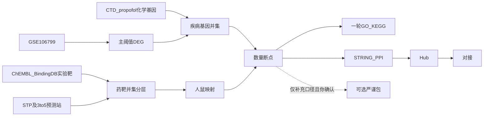

> 昱阳课题研究计划 SSOT。存放规范见同项目 `00_文件存放映射_FileLayout.md`。  
> 口径：计算预测；非重复暴露湿实验；非槲皮素给药臂。  
> 已引用：研究方案编排 + 网络药理学 + 网络毒理学 + RNA-seq/DEG + 分子对接（执行阶段再打开各技能 SSOT）。

## 1. 科学问题（锁定表述）

基于 **GSE106799** 鉴定新生小鼠丙泊酚暴露相关 DEG，结合 **CTD 化学–基因（propofol）** 补充疾病侧；药物侧为槲皮素 **实验活性靶（ChEMBL ± BindingDB）∪ 多源预测靶**；取交集预测潜在干预靶点与通路，并对核心靶点做分子对接。

**禁止写法：**「槲皮素治疗丙泊酚重复暴露小鼠」——无给药臂、非多日重复暴露、结论仅为 in silico。

**可写：** 新生期丙泊酚暴露发育神经毒性 × 槲皮素（计算预测干预靶点）。

## 2. 双口径目录（同级）

```text
昱阳项目/
  01_分析报告_AnalysisReport/          ← 计划与汇总（共用）
  02_未补充口径_Baseline_STPonly/      ← 备份冻结：仅 STP × DEG
  03_补充口径_Expanded_MultiSource/    ← 主执行：实验∪预测 × DEG∪CTD
```

每个口径内部步骤同级编号：

| 子目录 | 阶段 | 说明 |
|--------|------|------|
| `01_差异分析与药靶断点_DEGandGate` | A | DEG + 药靶 + 断点 |
| `02_可选严谨包_RigorOptional` | B | **默认不跑**；见下 |
| `03_富集与PPI_EnrichPPI` | C | 一轮 GO/KEGG + PPI |
| `04_分子对接_Docking` | C | 对接 |

### 严谨包决策

| 口径 | 严谨包 |
|------|--------|
| **未补充** | **确认不执行**；STATUS = `SKIPPED_CONFIRMED_DONE`（目录保留；不加宽口径不做严谨包） |
| **补充** | **已确认试跑**；STATUS = `DONE`（旁路：阈值敏感性 / 超几何 / GSEA / 多站共识；**不改**主交集名单） |

## 3. 分析路线（补充口径 = 主线）



### 药靶：并集 + 分层（非交集作门槛）

| 层 | 来源 | 标签 |
|----|------|------|
| 实验 | ChEMBL（CHEMBL50）；BindingDB（可达时） | `experimental` |
| 预测 | SwissTargetPrediction + 另 3–5 预测站 | `predicted` |
| **主池** | **实验 ∪ 预测** | 分表可溯源 |
| 双证据 | 实验 ∩ 预测 | 仅排序/优先湿实验，不作唯一名单 |

实验靶过滤（写死）：优先 binding 类；有标准值时 **≤ 10 µM**（或等价 pChEMBL）；物种优先人源再同源小鼠。

预测站（补充口径目标 4–6 源，含 STP）：STP（已入库）；PharmMapper / TargetNet / BATMAN 已入库；SEA / Super-PRED 接口不可用时手工导出。**各源筛选门槛见** `03_补充口径_Expanded_MultiSource/.../04_预测靶点_MultiPredict/DATA_SOURCE.md`（PharmMapper **已采纳加宽版**：研究相关物种=小鼠∪人 ∩ Normalized Fit ≥ 0.6；≥0.8 仅作严格审计）。每源独立 CSV + 证据标签。

### 疾病基因（补充口径）

| 层 | 来源 | 规则 |
|----|------|------|
| 主 | GSE106799 DEG | `\|logFC\|≥1 & P<0.05`（与已跑一致） |
| 补充 | CTD 化学–基因 *propofol* | curated 优先；人/鼠 → 小鼠符号 |
| **主池** | **DEG ∪ CTD** | 分表标明来源 |
| **明确不做** | P60 文献基因表；宽病名疾病六库并集 | — |

未补充口径：疾病 = 仅 DEG；药物 = 仅 STP（Probability>0）——已跑通并冻结备份。

### 阶段

- **A**：PCA/DEG（可复用）→ 药靶整合 → 人鼠映射 → 断点表  
- **B**：可选严谨包（见上表）  
- **C**：一轮富集（交集&lt;15 则 ORA 用全疾病基因池）→ PPI → 对接 Top hub  
- **明确不做**：WGCNA、ML 选 hub、双轮 ORA、治疗因果宣称  

后续湿实验：优先 **实验靶 ∩ 疾病**，其次高概率/多站共识预测 ∩ 疾病。

## 4. 数据来源摘要

| 侧 | 未补充口径 | 补充口径 |
|----|------------|----------|
| 疾病 | GSE106799 DEG | DEG ∪ CTD(propofol) |
| 药物 | STP only | ChEMBL±BindingDB ∪ 多预测站 |
| GEO 主集 | GSE106799 | 同左（不换 GSE186216/200968 作毒性主 DEG） |

配体：PubChem CID **5280343**（Quercetin）。  
PPI：STRING；对接：Vina/AutoDock-GPU 按对接技能 SOP。

## 5. 技能组合（有序）

1. DataAuthenticity — GSE106799  
2. RNA-seq — DEG / 火山 / 热图  
3. NetworkToxicology — CTD 化学–基因  
4. NetworkPharmacology — 药靶分层、韦恩、PPI  
5. GSEA-Pathway — 一轮 ORA（及你确认后的可选 GSEA）  
6. MolecularDocking — 槲皮素–hub  
7. VizStandards + DeliveryStandards  

## 6. 交付物

- 双口径各自：断点表、药靶分层表、疾病并集表、交集、一轮 GO/KEGG、PPI/hub、对接（补充口径跑通；未补充对接/富集可标跳过或未展开）  
- 报告汇总在 `01_分析报告`  
- 口径：in silico / 计算预测；DPI≥600；图面 English  

## 7. 风险与局限

- 公开小鼠丙泊酚毒性 bulk 几乎仅 GSE106799；样本量小  
- STP 训练背景含 ChEMBL，实验靶与预测部分重叠 → 必须分层，勿称「完全独立验证」  
- 多预测站并集抬假阳性；用证据标签与（可选）≥2 站共识降噪  
- 对接 ≠ 湿实验验证  
- CTD 边为策展关联，不等于本实验因果  

---

**执行默认（本版锁定）：**  
补充口径为主线；药靶 = 实验 ∪ 预测（分层）；疾病 = DEG ∪ CTD；不做 P60、不做宽病名六库；未补充口径备份冻结且严谨包不执行；补充口径严谨包已试跑（旁路，不改主交集）。
