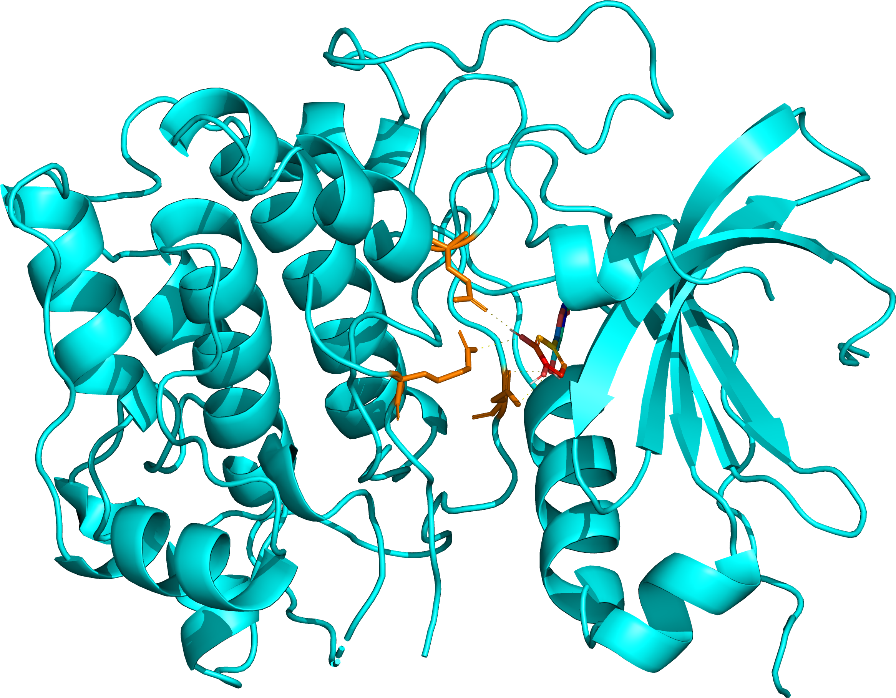

# 昱阳项目最终分析报告（Final Report）

> **课题**：新生期丙泊酚暴露发育神经毒性 × 槲皮素 —— 计算预测干预靶点与分子机制（in silico）
> **口径**：主结论以 **03_补充口径_Expanded_MultiSource**（实验∪预测药靶 × DEG∪CTD）为准；**02_未补充口径_Baseline_STPonly** 仅作对照。
> **数据溯源**：`data_provenance: REAL`（GEO GSE106799、CTD、ChEMBL、BindingDB、SwissTargetPrediction、PharmMapper、TargetNet、BATMAN-TCM、STRING、RCSB PDB；均可核对来源与参数，见各模块 `DATA_SOURCE.md`）。
> **口径红线（研究计划 §1）**：本研究**无给药臂、非重复暴露湿实验**，全部为计算预测。禁止表述为「槲皮素治疗丙泊酚重复暴露小鼠」；正确表述为「新生期丙泊酚暴露发育神经毒性 × 槲皮素（计算预测干预靶点）」。
> **更新**：2026-10-14（MD 进行为当日状态快照，见 §6）

---

## 0. 摘要

1. 以 GEO **GSE106799**（新生小鼠丙泊酚暴露）鉴定主阈值 DEG **120** 个（↑82/↓38），并用 **CTD 化学–基因（propofol）** 补充疾病侧，疾病基因并集小鼠 **298** 个。
2. 药物侧（槲皮素，PubChem CID 5280343）构建**分层药靶**：实验活性靶（ChEMBL+BindingDB）**174** ∪ 多源预测靶（STP+PharmMapper+TargetNet+BATMAN-TCM）**484**，人鼠映射后并集 **471**。
3. 药∩病交集 **57** 基因（其中实验靶∩病 **12**、双证据 **9**），显著富集于**神经元凋亡调控、缺氧应答、细胞凋亡**等通路（GO BP：regulation of neuron apoptotic process，21 基因，p≈2.0×10⁻²⁵；KEGG：Apoptosis、EGFR tyrosine kinase inhibitor resistance 等）。
4. STRING PPI（v12.5，57 基因 → **712** 条互作边）核心 hub：**Akt1(42)、Il6(41)、Jun(41)、Stat3(41)、Mtor(40)、Tnf(40)**、Casp3/Fos/Hif1a/Mapk3(39)。
5. 对 5 个核心靶（AKT1/EGFR/GSK3B/SRC/HIF1A）分子对接：槲皮素结合能 **−7.6 ~ −8.7 kcal/mol**（AKT1、EGFR 最强 −8.7），支持其与核心靶点的潜在结合。
6. 分子动力学（GROMACS 100 ns）：demo 体系 3HTB+JZ4 已完成并出图；5 个课题体系处于重搭–续跑队列（详见 §6，**进行中**）。

## 1. 数据来源与溯源

| 数据 | 来源库 | 说明 | 登记位置 |
|------|--------|------|----------|
| 疾病 DEG | GEO GSE106799 | 小鼠，丙泊酚暴露 vs 对照，主阈值 DEG 120 | `01_差异分析与药靶断点_DEGandGate/01_数据文件_Data/01_初始数据_RawInitial/` |
| 疾病补充 | CTD | 化学–基因（propofol），并入疾病并集 298 | 同上 |
| 药物实验靶 | ChEMBL、BindingDB | 174 个人源实验活性靶 | `02_药物靶点_DrugTargets/01_初始数据_RawInitial/`（带来源库前缀） |
| 药物预测靶 | SwissTargetPrediction、PharmMapper、TargetNet、BATMAN-TCM | 484 个人源预测靶 | 同上 |
| PPI | STRING v12.5 API | species=10090，required_score=400 | `03_富集与PPI_EnrichPPI/01_数据文件_Data/01_初始数据_RawInitial/01_STRING_PPI网络_StringPpiNetwork/` |
| 富集 | clusterProfiler + org.Mm.eg.db + KEGG(mmu) | ORA，BH 校正 p<0.05 | 软件库（结果表登记） |
| 受体结构 | RCSB PDB | 1M17/3CQW/1H8F/2SRC/4H6J（人源激酶域） | `05_分子动力学_MD/01_初始数据_RawInitial/` |

**PPI 原始数据问题（用户问询，2026-10-14 已修复）**：此前 `03_富集与PPI_EnrichPPI` 没有 `01_初始数据_RawInitial`，原因是流水线对 STRING 为**运行时在线查询、只落盘派生表**（`06_STRING_edges.csv` 等），未保存 API 原始响应；上游基因表留在 DEGandGate 模块且未写指针；该目录早于 10-12 新命名规范建立。现已补登记 STRING 12.5 原始快照（ID 映射 + 互作网络 JSON）+ `DATA_SOURCE.md` + `README_原始数据来源.md`（双口径均已补），快照与派生表逐边对账一致（补充口径 712 边；基线 8 边）。详见各模块 `01_初始数据_RawInitial/README_原始数据来源.md`。

## 2. 阶段 A：DEG 与数量断点

### 2.1 基线口径（对照）

- STP（Homo sapiens，Probability>0）：100 行 → 99 基因符号 → 小鼠映射 **85**。
- 药∩病（× DEG 120）= **1（Alox15）** → 无网络药理学意义上的交集，触发回退：ORA 用全 DEG、PPI 用 top-50 DEG。
- 结论：单靠 STP 预测靶不足以支撑该课题的机制推断（**诚实阴性对照**）。

### 2.2 补充口径（主线）

| 指标 | 数量 |
|------|------|
| 实验靶（人，ChEMBL+BindingDB） | 174 |
| 预测靶（人，STP+PharmMapper+TargetNet+BATMAN） | 484 |
| 药靶并集（小鼠映射） | 471 |
| 疾病并集（小鼠，DEG 120 ∪ CTD 178） | 298 |
| **药∩病** | **57** |
| 实验∩病 | 12 |
| 双证据（实验+预测）∩病 | 9 |

断点结论详见 `02_阶段汇总_StageSummaries/02_补充口径断点结论_GateDecision_Expanded.md`。严谨包（阈值敏感性/超几何/GSEA/多站共识）已试跑为**旁路**，不改主交集名单。

## 3. 阶段 C：GO/KEGG 富集（补充口径，ORA on 交集 57 基因）

**GO BP Top（FDR<0.05）**：

| 条目 | 基因数 | p 值 |
|------|--------|------|
| regulation of neuron apoptotic process | 21 | 2.0×10⁻²⁵ |
| neuron apoptotic process | 21 | 6.1×10⁻²⁴ |
| response to hypoxia | 20 | 9.8×10⁻²⁴ |
| regulation of apoptotic signaling pathway | 20 | 2.6×10⁻²¹ |

**KEGG Top**：EGFR tyrosine kinase inhibitor resistance（16 基因，p=2.9×10⁻²²）、**Apoptosis**（17 基因，p=6.0×10⁻²⁰）、Kaposi sarcoma-associated herpesvirus infection、Hepatitis B、Lipid and atherosclerosis 等。

**解读**：富集主题高度集中于**神经元凋亡调控与缺氧应答**，与「发育神经毒性」表型方向一致；KEGG 疾病类条目（病毒感染/肿瘤）多由共享的凋亡–MAPK–PI3K 骨架基因驱动，解读时应聚焦 Apoptosis 等机制类通路。

- 图：[`../../03_补充口径_Expanded_MultiSource/03_富集与PPI_EnrichPPI/03_图片文件_Figures/01_气泡图_GO_BPCCMF_Bubble.png`](../../03_补充口径_Expanded_MultiSource/03_富集与PPI_EnrichPPI/03_图片文件_Figures/01_气泡图_GO_BPCCMF_Bubble.png)、`03_棒棒糖图_KEGG_Pathways_Lollipop.png`、`08_圈图_KEGG_Circos.png`（网药 FROZEN 图序）
- 基线口径：GO/KEGG 均 `no_significant_terms`（回退 top-50 DEG 无显著条目），与 §2.1 阴性结论一致。

## 4. 阶段 C：STRING PPI 与核心 Hub

- 输入：药∩病 57 基因（全部映射成功）；**712** 条互作边（STRING v12.5，required_score=400）。
- Hub Top10（degree）：**Akt1 42、Il6 41、Jun 41、Stat3 41、Mtor 40、Tnf 40、Casp3 39、Fos 39、Hif1a 39、Mapk3 39**。
- 结构特征：网络呈高度互联的核心模块，hub 集中于 **PI3K-Akt-mTOR、MAPK（Jun/Fos/Mapk3）、炎症（Il6/Tnf）、凋亡（Casp3）、缺氧（Hif1a）**——与 GO/KEGG 富集主题互相印证。
- 图：`13_网络图_StringPPI_Degree_Network.png`（同心 Degree 布局，网药 FROZEN）
- 原始数据：`01_初始数据_RawInitial/01_STRING_PPI网络_StringPpiNetwork/`（2026-10-14 补登记，与派生表逐边对账一致）。

## 5. 阶段 C：分子对接（核心靶 × 槲皮素）

方法：AutoDock-GPU 冻结路线（定心决策树、`center_source` 登记、PyMOL 断点出图），受体为人源激酶域（缺原子/杂质按规范清理）。结合能（kcal/mol）：

| 靶点 | PDB | 结合能 |
|------|-----|--------|
| AKT1 | 3CQW | **−8.7** |
| EGFR | 1M17 | **−8.7** |
| GSK3B | 1H8F | −8.3 |
| SRC | 2SRC | −8.1 |
| HIF1A | 4H6J | −7.6 |

5 个靶点结合能均 < −7.5 kcal/mol，其中 AKT1/EGFR 最强。对接位点与残基相互作用图见 `04_分子对接_Docking/03_图片文件_Figures/0X_{靶}/图片/big-0X.png`（结合模式）、`detail-0X.png`（残基断点）、`surface-0X.png`（表面视图）；结合能矩阵见 `01_数据文件_Data/02_结果数据_ResultTables/矩阵_结合能_DockingAffinityMatrix.csv`。

## 6. 阶段 D：分子动力学（100 ns，GROMACS 2024.4）

**状态快照：2026-10-14 09:00（进行中，非最终结论）**

| 体系 | 状态 | 说明 |
|------|------|------|
| 3HTB+JZ4（demo，非课题配体） | ✅ 100 ns 完成 | FROZEN 图册 01–26 已按 `出图与交付约束_MdFigureStandards.md` 重绘，位于 `05_分子动力学_MD/03_图片文件_Figures/3HTB_JZ4_100ns/` |
| AKT1 3CQW+QUE | 🔄 断点续跑中（今晨自 6.9 ns 续跑） | 昨夜因机器休眠中断（mdrun 被杀），检查点完好 |
| GSK3B 1H8F+QUE | 🔄 排队中 | 旧 pose 提取 bug 的碰撞构象已修（MODEL3，最小原子间距 1.22 Å） |
| SRC 2SRC+QUE | 🔄 排队中 | LYS423 侧链缺原子已 pdbfixer 补全 |
| HIF1A 4H6J+QUE | 🔄 排队中 | THR327/LYS328 缺原子已补全 |
| EGFR 1M17+QUE | ⚠️ 待决 | 口袋内 2 个姿态（MODEL1/MODEL2）均在 <1 ns 内配体飞散（ligand RMSD≈8.7 nm）→ 建议**换口袋重新对接**后再入列 |

- 首轮失败原因统计：`05_分子动力学_MD/04_报告文件_Reports/03_MD失败原因统计_FailureTally.md`（A 姿态不稳 / B 侧链缺原子 / C grompp 警告与脚本缺陷）。
- 重搭与修复全过程：`05_分子动力学_MD/04_报告文件_Reports/05_重搭与修复记录_RepairAndRetry.md`。
- 运行保障：分块 1 ns + 断点 `-cpi` 续跑、watchdog 监控（配体飞散/停摆即停）、QQ 邮件告警、完成后自动按 FROZEN 图序出图。

## 7. 命名与存放合规（2026-10-12 规范）

- ✅ 原始数据补**来源库前缀**（`02_STP_槲皮素靶点_QuercetinTargets`、`02_STP_STITCH_PharmMapper_TargetNet_BATMAN_预测靶点` 等，35+ 处路径指针同步更新；杂物文件已清理）。
- ✅ MD 模块补 `01_初始数据_RawInitial`（RCSB+AutoDock MD 输入登记）；工作目录归 `05_工作文件_MdWork`、图表归位。
- ✅ PPI 模块补 `01_初始数据_RawInitial`（STRING 原始快照 + 双口径 `README_原始数据来源.md`），本报告 §1 详述。

## 8. 局限（必读）

1. **全链条 in silico**：无给药臂、无湿实验验证；所有「干预靶点/机制」表述均为计算预测，**不构成诊疗建议**。
2. **多库并集抬高假阳性**：预测靶 484 个来自 4 个预测站并集，特异性有限；已用「实验∩病 12 / 双证据 9」分层缓解，但不能消除。
3. **基线口径为诚实阴性**：STP×DEG 交集仅 1（Alox15），任何结论不得基于基线口径外推。
4. **STRING/ORA 偏倚**：hub 度数受研究热度偏倚；KEGG 疾病类条目由共享骨架基因驱动（§3）。
5. **对接局限**：刚性受体、打分为经验函数；结合能不等于功效。
6. **MD 尚未完成**（§6）；EGFR 口袋内姿态不稳定提示该口袋–配体组合存疑，换口袋重对接前**不解读 EGFR 的 MD 结论**。

## 9. 结论

在补充口径下，槲皮素的药靶与丙泊酚暴露相关疾病基因存在 **57 个交集**，富集于**神经元凋亡调控、缺氧应答、凋亡信号通路**；PPI 核心为 **Akt1–Stat3–Mtor–Il6/Tnf–Jun/Fos–Casp3–Hif1a** 模块。槲皮素与 AKT1/EGFR/GSK3B/SRC/HIF1A 的对接结合能均达 −7.6 kcal/mol 以下，支持其作为潜在干预节点的计算假说。分子动力学稳定性验证进行中（§6）；后续以 MD 完成后的 RMSD/RMSF/氢键/FEL 图册与 MM-GBSA（若开）为最终稳定性判据。

---

## 交付物索引

| 内容 | 路径 |
|------|------|
| 研究计划（SSOT） | `../01_课题说明_ProjectBrief/01_研究计划_ResearchPlan.md` |
| 数据来源总览 | `../01_分析报告_AnalysisReport/02_数据来源总览_DATA_SOURCE.md` |
| 数量断点结论 | `../02_阶段汇总_StageSummaries/02_补充口径断点结论_GateDecision_Expanded.md` |
| 富集与 PPI（图/表/STATUS） | `../../03_补充口径_Expanded_MultiSource/03_富集与PPI_EnrichPPI/` |
| 对接（图/表/STATUS） | `../../03_补充口径_Expanded_MultiSource/04_分子对接_Docking/` |
| MD（报告/图/工作目录） | `../../03_补充口径_Expanded_MultiSource/05_分子动力学_MD/` |
| PPI 原始数据补登记 | `../../03_补充口径_Expanded_MultiSource/03_富集与PPI_EnrichPPI/01_数据文件_Data/01_初始数据_RawInitial/README_原始数据来源.md` |
