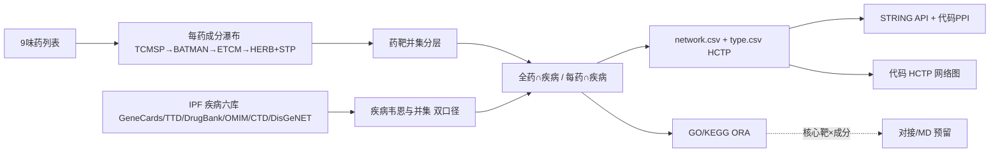

# 清风项目 · 研究计划（SSOT）

> 存放规范见同项目 `00_文件存放映射_FileLayout.md`。  
> 口径：计算预测（in silico）网络药理学；非临床试验、非诊疗建议。  
> 已引用：研究方案编排 + 网络药理学 + 统一交付规范 + 统一可视化规范（执行阶段再打开各技能 SSOT）。

## 1. 科学问题（锁定表述）

**水蛭宣痹化纤汤**（9 味）成分–靶点与**特发性肺纤维化（Idiopathic pulmonary fibrosis, IPF）**疾病靶点取交集，构建「药–成分–靶点–通路」网络并做 GO/KEGG 富集与 STRING PPI，预测该方干预 IPF 的潜在靶点与通路机制；核心靶点可下游对接/MD 验证。

**禁止写法：**「水蛭宣痹化纤汤治疗特发性肺纤维化」——无临床/实验数据，结论仅为计算预测。  
**可写：** 水蛭宣痹化纤汤干预 IPF 的潜在机制（网络药理学计算预测）。

## 2. 组方（用户给定 2026-10-14）

| 用户原词 | 规范名（药典/TCMSP 检索用） | 拼音 | 拉丁/药材名 |
|----------|------------------------------|------|-------------|
| 水蛭 | 水蛭 | ShuiZhi | Hirudo |
| 旋覆花 | 旋覆花 | XuanFuHua | Inulae Flos |
| 川穹 | **川芎**（原词疑为同音笔误） | ChuanXiong | Chuanxiong Rhizoma |
| 桃仁 | 桃仁 | TaoRen | Persicae Semen |
| 浙贝母 | 浙贝母 | ZheBeiMu | Fritillariae Thunbergii Bulbus |
| 密麻黄 | **蜜麻黄**（原词疑为同音笔误，蜜炙麻黄） | MiMaHuang | Ephedrae Praeparata |
| 紫苏子 | 紫苏子 | ZiSuZi | Perillae Fructus |
| 黄芪 | 黄芪 | HuangQi | Astragali Radix |
| 甘草 | 甘草 | GanCao | Glycyrrhizae Radix |

> ✅ 川芎/蜜麻黄两处规范化**用户已确认**（2026-10-14）。若确用生麻黄请另行说明。

**疾病（英文病名，六库检索用）：** Idiopathic pulmonary fibrosis（IPF）；MeSH: D054990。

## 3. 目录与阶段

```text
清风项目/
  00_文件存放映射_FileLayout.md          ← 目录 SSOT
  01_分析报告_AnalysisReport/            ← 本计划 + 数据来源 + 阶段汇总 + 最终报告（HTML 按 DeliveryStandards 范式）
    01_疾病靶点_DiseaseTargets/          ← A：疾病六库导出 → 韦恩/并集（双口径：全量 vs Relevance≥40 下游）
    02_药物靶点_DrugTargets/             ← B：9 药成分瀑布（TCMSP→BATMAN仅已知→ETCM→HERB+STP）
    03_药病交集与网络_OverlapAndNetwork/ ← C：全药∩疾病、每药∩疾病、network.csv+type.csv（HCTP A/B/C/D）
    04_富集与PPI_EnrichPPI/              ← C：STRING PPI + GO/KEGG ORA + 代码出图（网药 FROZEN 图序）
    05_分子对接_Docking/                 ← D（预留）：核心靶 × 核心成分，AutoDock-GPU 冻结路线
```

每个模块内部：`01_数据文件_Data/{01_初始数据_RawInitial, 02_结果数据_ResultTables}` + `02_代码文件_Code` + `03_图片文件_Figures` + `04_报告文件_Reports`。  
原始数据命名强制来源库前缀（SampleLayoutNaming §2.1）。

## 4. 分析路线（对齐网药库与流水线 SSOT）



**疾病双口径（出图约束 §0a，强制）：** 韦恩用完整 GeneCards 全量；下游过滤用 Relevance Score ≥ 40 ∪ TTD ∪ DrugBank ∪ OMIM ∪ CTD；两套数字都要写清。

**药物瀑布（三类库不得混写）：** TCMSP（OB≥30%, DL≥0.18）→ BATMAN-TCM（**仅 known/curated**，禁预测靶）→ ETCM 补充 → HERB 成分 SMILES → SwissTargetPrediction（剔除 Probability=0）。口径分层登记实验/预测靶。

## 5. 数据库可达性与获取策略

详见 [`02_数据来源总览_DATA_SOURCE.md`](02_数据来源总览_DATA_SOURCE.md)（含 2026-10-14 实测连通矩阵）。原则：

1. **官方 API/bulk 优先**（STRING API、KEGG REST、PubChem PUG、CTD bulk）；
2. **注册/登录通道**（DisGeNET 学术注册、DrugBank 学术许可、GeneCards 注册导出）；
3. **前端接口复现兜底**（DevTools 抓取页面调用的 JSON 接口 → 脚本化调用）：限速、带 UA、缓存原始响应、**不二次分发**库方导出、DATA_SOURCE 登记 endpoint+参数+日期；
4. **禁止**绕过付费墙/验证码/破解授权；商业库导出仅限本课题科研使用。

## 6. 严谨包决策

默认**旁路可选**（阈值敏感性 / 超几何 / GSEA），不改主交集名单；跑否待你确认。

## 7. 交付物

- 疾病韦恩/并集图（双口径两套数字）、HCTP 网络图（网药 FROZEN）、PPI Degree 同心图、GO/KEGG 气泡/柱/棒棒糖/圈图（01–15 图序对齐样例）
- `network.csv` + `type.csv`（A药/B成分/C靶点/D通路）、审计表、异常清单
- 最终 HTML 报告（`write_delivery_report()` 范式：KPI + 分组图 + 解读 + 「没证明什么」）
